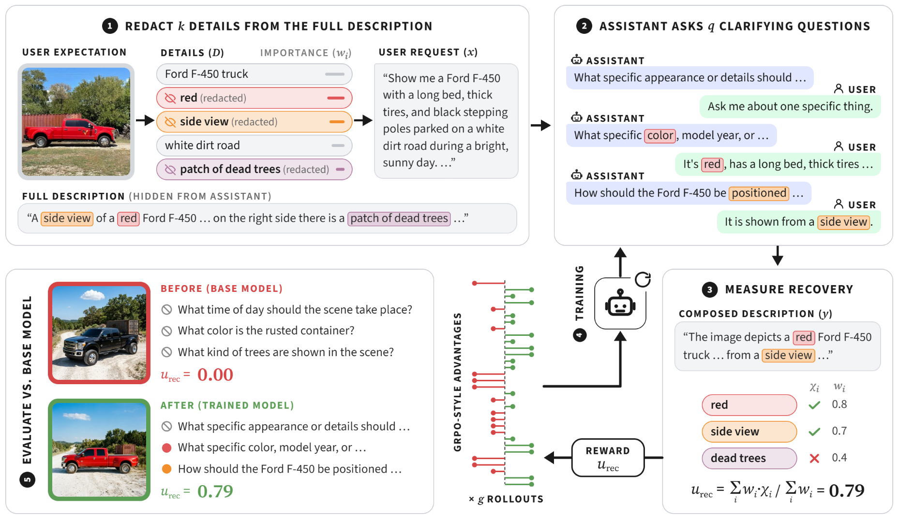

# Learning to Clarify Underspecified Intents Under Limited Interaction


> [!NOTE]
> Code for the paper **Learning to Clarify Underspecified Intents Under Limited Interaction**.

AI assistants receive requests that leave out information needed for a good outcome, for example about users' preferences or goals. They must then either speculate or ask for more information before proceeding. We reconceptualize this as a value-of-information problem: the assistant should acquire information whose absence causes the greatest avoidable loss in user utility. This is rarely known *ex ante*; rather, assistants must *predict* it in order to optimally allocate limited user interactions. We instantiate this problem in image generation and derive a reinforcement learning framework using multi-turn simulated users to maximize utility recovery under uncertainty. In a preregistered study with 456 interactive sessions across 76 human participants, this helped users significantly better match reference images with significantly fewer questions, less total interaction time, and lower cost. This points toward a simple and scalable framework for training language model assistants to better disambiguate user intent by asking more informative questions.



## Features

- 🧩 Instance synthesis from hyper-detailed image descriptions (DOCCI): decompose into atomic details, redact a fixed or variable number of them, and rewrite the rest as a natural request
- 🗣️ Privileged user simulators that answer only what is asked, with patient and impatient stopping behavior
- 🎯 Asking modes: no-asking, fixed-asking, and open-asking
- 🏋️ RL fine-tuning of the asking policy with group-centered policy gradients and LoRA through the Tinker API
- ⚖️ Rubric judge scoring the recovered utility per hidden detail
- 🖼️ Image generation for references, requests, and final descriptions with Gemini
- 🤖 Support for multiple orchestration LLMs through LiteLLM and base models through Tinker
- ⚙️ Hydra-based configuration system for reproducible experiments

## Installation

Create a Python environment:

```bash
conda create -n uaug python=3.12
conda activate uaug
```

install the dependencies:

```bash
pip install uv
uv pip install -e .
```

and create a `.env` file in the project root with your API keys:

> [!IMPORTANT]
> You must include a Gemini key (the environment LLM and image generation) and a Tinker key (the assistant model and RL training).

```bash
GEMINI_API_KEY="<YOUR_GEMINI_KEY>"
TINKER_API_KEY="<YOUR_TINKER_KEY>"
```

> [!NOTE]
> All commands run from the repository root. The instances of the paper ship in `data/docci_instances/` and its 15 evaluations in `paper_results/`, and every command uses them by default.

## Synthesis

Decompose each description into atomic details with an importance weight and a check, redact some of them, and rewrite what remains as a natural user request. Skip this step to use the paper's instances. Otherwise download the DOCCI descriptions and build your own:

```bash
python scripts/setup_docci.py
python -m uaug.synthesis.run
```

**Options:**
- `synthesis`: variable-redactions (1 to `k` details per instance), fixed-redactions (exactly `k`)
- `general.k`: maximum (or fixed) number of redacted details (default: 15)
- `synthesis.num_sources`: number of sources to process (null for all)
- `llm`: gemini-3.5-flash-lite, gemini-3.8-flash

Results are saved in `results/image-gen/docci/synthesis/LLM/k_REDACTIONS/TIMESTAMP`, with `instances.{train,val,test}.jsonl` and a `synthesis_report.json`.

## Training

Each iteration samples instances, collects a group of rollouts per instance against the user simulator, judges them, and takes one policy-gradient step on LoRA weights with group-centered advantages.

```bash
python -m uaug.training.run \
  agent=fixed-asking \
  user=patient
```

**Options:**
- `agent`: fixed-asking (one question per hidden detail), open-asking (the model decides when to stop)
- `user`: patient (answers every question), impatient (stops after a random number of them)
- `model`: qwen3-8b, qwen3.5-9b
- `training.instances_dir`: instances to train on (default: data/docci_instances)
- `training.n_iterations`: number of iterations, one gradient step each (default: 300)

Results are saved in `results/image-gen/docci/training/MODEL/AGENT/USER/k_15/REWARD/WEIGHTING/TIMESTAMP`, with the per-iteration `training_log.jsonl`, every judged rollout in `trajectories.jsonl`, and `checkpoints.jsonl` mapping steps to Tinker sampler paths.

## Evaluation

Run one assistant over a split and judge every episode: it sees only the request, asks questions per its asking mode, and composes a final description that the judge checks against each hidden detail.

```bash
python -m uaug.evaluation.run \
  agent=open-asking \
  user=impatient \
  evaluation.split=test \
  model.checkpoint=tinker://CHECKPOINT
```

**Options:**
- `agent`: no-asking, fixed-asking, open-asking
- `user`: patient, impatient
- `evaluation.split`: val, test
- `evaluation.instances_dir`: instances to evaluate on (default: data/docci_instances)
- `model.checkpoint`: Tinker sampler path from `checkpoints.jsonl` (omit for the base weights)

Results are saved in `results/image-gen/docci/evaluation/MODEL/AGENT/USER/k_15/SPLIT/CHECKPOINT/TIMESTAMP`, with `episodes.jsonl`, `judgments.jsonl`, a one-row `summary.csv`, and recovery plots.

## Images & Figures

Render the reference, request and final images with Gemini:

```bash
python scripts/setup_docci_images.py
python scripts/generate_images_for_data.py --split test
python scripts/generate_images_for_eval.py
```

Make the figures of the paper from its evaluations (pass an evaluation directory to use another):

```bash
python scripts/visualize_images.py
python scripts/visualize_instance.py INSTANCE_ID
```

Figures are saved in `scripts/figures/`.

## Configuration

The framework uses [Hydra](https://hydra.cc/) for configuration management. Take a look into `uaug/conf/` to see all the details and options.

## Citing & Acknowledgements

If you use this code in your research, please cite the following paper:

```bibtex
TEMPORARY: add bibtex here
```
